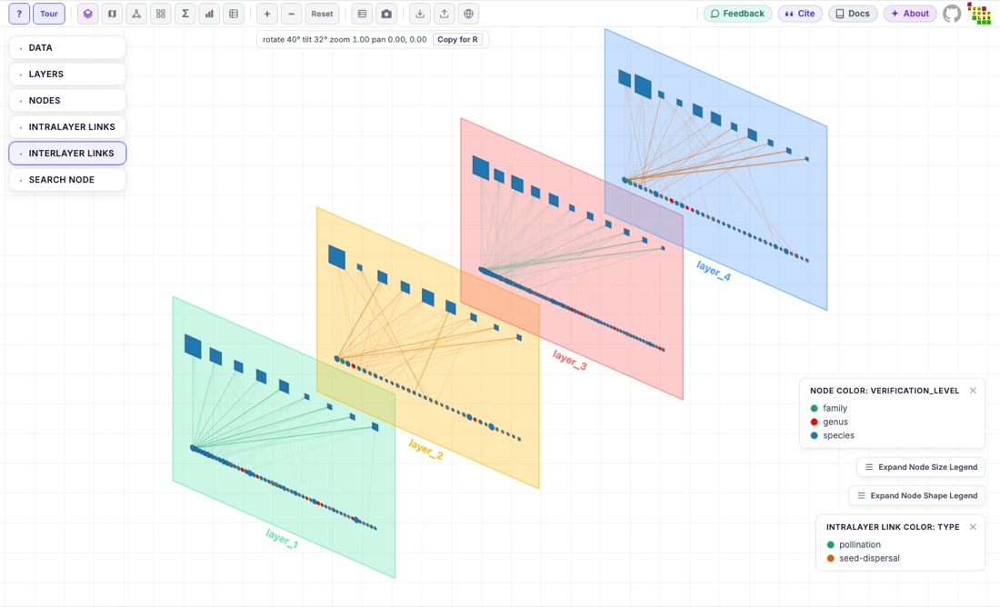
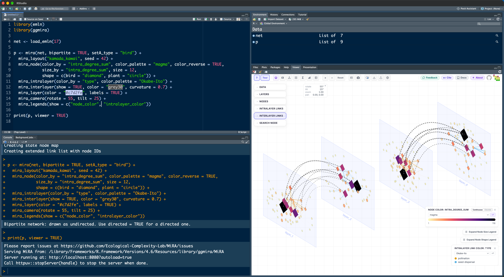

# ggmira 

<!-- badges: start -->
[](#lifecycle)
<!-- badges: end -->

## Overview

ggmira is an R interface to [MiRA](https://mira.ecomplab.com/), the
browser-based multilayer network visualizer. Its syntax follows ggplot2:
start from a base plot with `mira()` and add components with `+` to control
the nodes, links, layers and more. Using MiRA as the engine makes the plot
both reproducible, because it is described in code, and interactive,
because it opens in MiRA, where you can keep exploring and adjusting it.
A plot can open in any of MiRA's seven views (the stack of layers, a grid,
a map, a layer view, the meta-network, a dashboard and the data tables),
and use MiRA's other features, such as highlighting a node.

ggmira works with the multilayer objects of the
[emln](https://emln.ecomplab.com/) package, and includes its own copy of
MiRA, so there is nothing else to install. Plots need an internet
connection: MiRA loads its drawing libraries and map tiles from the web.


## Installation

ggmira is not on CRAN yet. Install the development version from GitHub:

```r
install.packages("emln")
# install.packages("remotes")
remotes::install_github("Ecological-Complexity-Lab/ggmira")
```

## Usage

```r
library(emln)
library(ggmira)

net <- load_emln(17) # 4 layers; birds and plants

mira(net, bipartite = TRUE, setA_type = "bird") +
  mira_layout("bipartite", seed = 42, nested = TRUE) +
  mira_node(color_by = "verification_level",
            color_values = c(genus = "red", species = "#1f77b4"),
            size_by = "intra_degree_sum", size = 8,
            shape = c(bird = "square", plant = "circle")) +
  mira_intralayer(color_by = "type", min_weight = 0.01) +
  mira_layer(color_by = "layer_name", labels = TRUE) +
  mira_legends(show = c("node_color", "intralayer_color"))
```



`plot_mira(net)` opens a network with MiRA's defaults; adjust it in MiRA,
and MiRA's R button gives the `mira()` code for the view. `mira_save()`
saves a plot as a PNG, JPG or PDF file. *Get started* builds a plot step by
step; the reference lists every component.

MiRA is best viewed on a large screen: it needs a window of at least
1024 x 600 pixels.

### In RStudio

Plots open in the browser, or in RStudio's Viewer pane, next to your code:
`print(p, viewer = TRUE)` for one plot, or `options(ggmira.viewer = TRUE)`
for every plot. Give the pane room, or click its *Show in new window*
button to move the plot to the browser.



## Getting help

Report problems and suggestions at
<https://github.com/Ecological-Complexity-Lab/ggmira/issues>, with the code
you ran and a screenshot of MiRA. Problems in MiRA itself go to
<https://github.com/Ecological-Complexity-Lab/MiRA/issues>.
