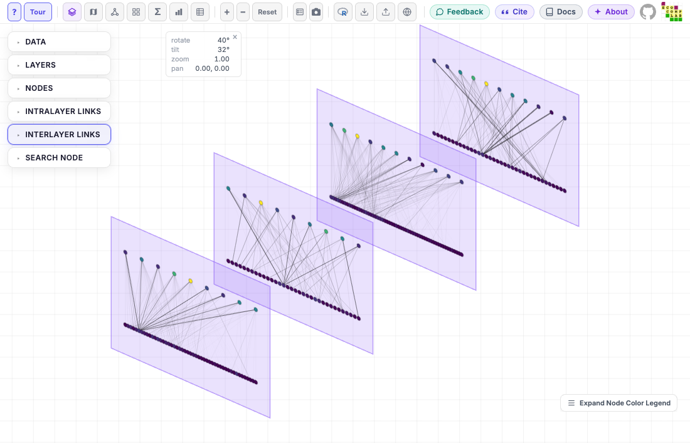

# Getting started

ggmira draws multilayer networks in [MiRA](https://mira.ecomplab.com/),
the browser-based multilayer network visualizer, and describes how they
should look with code, the way ggplot2 does: start from the network with
[`mira()`](https://ggmira.ecomplab.com/reference/mira.md) and add
**components** with `+`, one per part of the plot. Printing the plot
opens it in the browser with the settings applied; everything can still
be changed in MiRA’s interface.

This article builds one plot up, a component at a time, on emln network
17: four layers (pollination and seed dispersal on two Galápagos
islands), two node sets (birds and plants), and interlayer links between
layers 1–2 and 3–4. The screenshots show what each step looks like when
it opens.

``` r

library(emln)
library(ggmira)

net <- load_emln(17)
```

**MiRA is best viewed on a large screen.** It needs a window of at least
1024 x 600 pixels; in a smaller browser window, MiRA warns that buttons
and panels may be cut off. The warning is not shown in RStudio’s Viewer
pane. Plots also need an internet connection: MiRA loads its drawing
libraries and map tiles from the web.

Each plot starts a small local server; stop them all with
[`httpuv::stopAllServers()`](https://rstudio.github.io/httpuv/reference/stopAllServers.html).

emln has a
[`plot_multilayer()`](https://ggmira.ecomplab.com/reference/plot_mira.md)
of its own, and with emln attached after ggmira that is the one R finds.
Use ggmira’s
[`plot_mira()`](https://ggmira.ecomplab.com/reference/plot_mira.md), or
write
[`ggmira::plot_multilayer()`](https://ggmira.ecomplab.com/reference/plot_mira.md).

### In RStudio

Plots open in the browser. In RStudio they can open in the Viewer pane
instead: `print(p, viewer = TRUE)` for one plot, or
`options(ggmira.viewer = TRUE)` for every plot (put it in your
`.Rprofile` to keep it). Give the pane room: drag it wider, maximize it,
or click its *Show in new window* button to move the plot to the
browser. The [home
page](https://ggmira.ecomplab.com/index.html#in-rstudio) has a
screenshot.

## 1. The plot

[`mira()`](https://ggmira.ecomplab.com/reference/mira.md) starts the
plot. Printing it (typing its name) opens the network with MiRA’s
default view: a bipartite layout, nodes colored by set.

``` r

p <- mira(net, bipartite = TRUE, setA_type = "bird")
p
```


### What the network offers

Before adding components, see what the network offers.
[`mira_options()`](https://ggmira.ecomplab.com/reference/mira_options.md)
lists what each component’s arguments can take: the columns and the
attributes MiRA computes, the scale type MiRA gives each (`*`:
`color_scale` can switch it) and its values. On a bipartite network
where the two node sets have different attributes, it also shows which
sets have each. Give it the same arguments as
[`mira()`](https://ggmira.ecomplab.com/reference/mira.md):

``` r

opts <- mira_options(net, bipartite = TRUE, setA_type = "bird")
opts[opts$component == "mira_node", ]
#> mira_node()
#>   color_by  node_type           categorical  node        2 values: bird, plant
#>             taxa_verified       categorical  node        2 values: FALSE, TRUE
#>             verification_level  categorical  node        3 values: family, genus, ...
#>             type                categorical  state node  2 values: bird, plant
#>             (computed)          continuous*  computed    12 attributes, e.g. intra...
#>             .set                set          keyword     one color per set: plant,...
#>   size_by   (computed)          continuous   computed    12 attributes, e.g. intra...
#> * MiRA's default scale; color_scale can choose the other (see ?mira_scales)
#> nodes
```

The whole table also covers the links, the layers, the columns
[`mira_filter()`](https://ggmira.ecomplab.com/reference/mira_filter.md)
and `mira_mode_meta(layers = )` conditions can use, and the
meta-network’s measures.

The computed attributes are each node’s degree (its number of links) and
strength (the sum of their weights), within layers (`intra_`) and
between them (`inter_`): per layer (`intra_degree`), and summed or
averaged over a node’s layers (`intra_degree_sum`, `intra_degree_mean`).
On a directed network the names carry the direction: `intra_in_degree`,
`intra_out_degree`.
[`?mira_node`](https://ggmira.ecomplab.com/reference/mira_node.md) has
the full list.

## 2. Layout: where the nodes go

[`mira_layout()`](https://ggmira.ecomplab.com/reference/mira_layout.md)
chooses the layout algorithm; a `seed` makes the positions reproducible
(without one, most layouts start from random positions and differ each
time the plot opens). Adding a component to `p` gives a new plot, so you
can keep the result (`p <- p + ...`) or just look at it (`p + ...`).

``` r

p <- p + mira_layout("kamada_kawai", seed = 42)
p
```


## 3. Nodes

In every element component, `color_by` and `size_by` map an attribute of
the data: a column of the network’s tables, or one MiRA computes, such
as `intra_degree_sum`. `color`, `size` and `shape` set constants. Here
nodes are colored by their taxonomic verification level, with two levels
given colors by hand (`color_values`; the third keeps MiRA’s palette),
and sized by degree. `size` is the base size, from 3 to 25 (MiRA’s
default is 10); node names, with `labels = TRUE`, have `label_size` 8 to
24 (default 12).

``` r

p <- p + mira_node(
  color_by = "verification_level",
  color_values = c(genus = "red", species = "#1f77b4"),
  size_by = "intra_degree_sum", size = 8
)
p
```


On a bipartite network, `color_by`, `size_by` and `shape` also take one
value per node set, named by `node_type`:
`color_by = c(bird = "intra_degree_sum", plant = NA)` colors birds by
degree and leaves plants in MiRA’s default (see
[`?mira_node`](https://ggmira.ecomplab.com/reference/mira_node.md)).
Shapes are `"circle"`, `"square"`, `"triangle"` and `"diamond"`, all
with the same area so sizes stay comparable:
`shape = c(bird = "triangle", plant = "circle")`.

## 4. Links

[`mira_intralayer()`](https://ggmira.ecomplab.com/reference/mira_intralayer.md)
styles the links within layers: here colored by the link column `type`,
with the weakest links hidden.
[`mira_interlayer()`](https://ggmira.ecomplab.com/reference/mira_interlayer.md)
styles the links between layers; MiRA hides them by default, so its
other arguments show nothing without `show = TRUE` or `pairs`, which
shows only the links between some layers (and turns them on).

``` r

p <- p +
  mira_intralayer(color_by = "type", min_weight = 0.01) +
  mira_interlayer(color = "grey40", curvature = 0.8, min_weight = 0.5,
                  pairs = list(c("layer_1", "layer_2"), c("layer_3", "layer_4")))
p
```


## 5. Layers

[`mira_layer()`](https://ggmira.ecomplab.com/reference/mira_layer.md)
colors the layers (by a layer column, or one color per layer with
`color_by = "layer_name"`), shows their names (`label_size` 8 to 32;
MiRA’s default is 14), and arranges them: `stack` and `spacing`.

``` r

p <- p + mira_layer(
  color_by = "layer_name",
  color_values = c(layer_1 = "orange", layer_3 = "#9467bd"),
  labels = TRUE, label_size = 18,
  stack = "vertical", spacing = 250
)
p
```


## 6. Filter: draw part of the network

[`mira_filter()`](https://ggmira.ecomplab.com/reference/mira_filter.md)
keeps some nodes, links or layers, with a condition on the columns of
the network’s tables, as in
[`subset()`](https://rdrr.io/r/base/subset.html): `nodes` on
`net$nodes`, `links` on `net$extended`, `layers` on `net$layers`. Here,
all plants and two finches; a hidden node hides its links. MiRA shows
“Data filter active”, with a button to remove the filter. Conditions use
the columns as they are named in the tables: the node sets of this
network are in `type`, which MiRA (and
[`mira_options()`](https://ggmira.ecomplab.com/reference/mira_options.md))
calls `node_type`.

``` r

p + mira_filter(nodes = type == "plant" |
                  node_name %in% c("Geospiza_fuliginosa", "Geospiza_fortis"))
```


`layers` keeps whole layers, by name or by a condition; the layers it
keeps close up the stack. Here, the two layers north of latitude -0.6:

``` r

p + mira_filter(layers = latitude > -0.6)
```


## 7. Camera, legends and a highlighted node

Legends start minimized;
[`mira_legends()`](https://ggmira.ecomplab.com/reference/mira_legends.md)
opens them, all or some, and `position` moves them (alone, it also opens
them all).
[`mira_camera()`](https://ggmira.ecomplab.com/reference/mira_camera.md)
turns, tilts, zooms and pans the view; to find the values, move the view
with the mouse in MiRA and copy the code with MiRA’s R button (step 10).
`mira_node(highlight = )` makes a node and its neighbors stand out, as
when it is picked in MiRA’s Search Node. In MiRA, all of this can still
be changed with the mouse.

The camera is relative to the browser window: the same call gives the
same framing in a larger or smaller window (another screen or computer),
but not identical pixels, so use the same window size when figures must
match. Layers dragged one by one (Cmd/Ctrl+drag) are not part of the
camera.

``` r

p + mira_legends(show = c("node_color", "layer_color"), position = "top-right") +
  mira_camera(rotate = 60, tilt = 25) +
  mira_node(highlight = "Geospiza_fortis")
```


## 8. Views: MiRA’s modes

MiRA shows a network in several views, which MiRA calls *modes*. A
`mira_mode_*()` component opens the plot in one of them; the other
components still apply where MiRA uses them.
[`mira_mode_grid()`](https://ggmira.ecomplab.com/reference/mira_mode_grid.md)
puts the layers side by side, with the node, link and layer settings of
the plot:

``` r

p + mira_mode_grid(columns = 2)
```


[`mira_mode_meta()`](https://ggmira.ecomplab.com/reference/mira_mode_meta.md)
opens the meta-network, each node once with its links from all layers
combined; here, link weights summed over layers and nodes colored by the
number of layers they are in:

``` r

p + mira_mode_meta(aggregation = "weights", color_by = "participation")
```


Node shapes set with `mira_node(shape = )` carry over to the
meta-network, with a shape legend when birds and plants have different
shapes.

`layers` selects layers in the meta-network’s *Filter Layers* panel: the
nodes and links of the other layers are dimmed. It takes layer names or
a condition on the columns of `net$layers`, like
[`mira_filter()`](https://ggmira.ecomplab.com/reference/mira_filter.md);
here, the two layers north of latitude -0.6:

``` r

p + mira_mode_meta(layers = latitude > -0.6)
```


[`mira_mode_map()`](https://ggmira.ecomplab.com/reference/mira_mode_map.md),
[`mira_mode_layer()`](https://ggmira.ecomplab.com/reference/mira_mode_layer.md),
[`mira_mode_dashboard()`](https://ggmira.ecomplab.com/reference/mira_mode_dashboard.md)
and
[`mira_mode_data()`](https://ggmira.ecomplab.com/reference/mira_mode_data.md)
open the other views with MiRA’s defaults. A few rules:

- A plot opens in **one view**. Adding a second `mira_mode_*()` of
  another view replaces the first, with a warning; to see two views,
  make two plots.
- [`mira_camera()`](https://ggmira.ecomplab.com/reference/mira_camera.md)
  works in the **network view only**, and
  [`mira_filter()`](https://ggmira.ecomplab.com/reference/mira_filter.md)
  in the **network, grid and map views**; the layer view applies its
  `layers` only. R warns when either is combined with a view that does
  not use it. The meta-network shows the whole network; to dim layers in
  it, use `mira_mode_meta(layers = )`.
- The map needs `latitude` and `longitude` in `net$layers`.
- The layer view and the meta-network have their own legends, which
  start open; `mira_legends(position = )` and `show = FALSE` apply to
  them.
- [`?mira_mode`](https://ggmira.ecomplab.com/reference/mira_mode.md) has
  a table of what applies in each view.
- `plot_mira(net, mode = "meta")` opens a network in any view with no
  components, with MiRA’s defaults.

The same plot in one expression, as in ggplot2:

``` r

mira(net, bipartite = TRUE, setA_type = "bird") +
  mira_layout("kamada_kawai", seed = 42) +
  mira_node(color_by = "verification_level",
            color_values = c(genus = "red", species = "#1f77b4"),
            size_by = "intra_degree_sum", size = 8) +
  mira_intralayer(color_by = "type", min_weight = 0.01) +
  mira_interlayer(color = "grey40", curvature = 0.8, min_weight = 0.5,
                  pairs = list(c("layer_1", "layer_2"), c("layer_3", "layer_4"))) +
  mira_layer(color_by = "layer_name",
             color_values = c(layer_1 = "orange", layer_3 = "#9467bd"),
             labels = TRUE, label_size = 18,
             stack = "vertical", spacing = 250)
```

Anything not set keeps MiRA’s default. When a setting is given twice,
the later component wins, so `p + mira_node(color = "grey50")` recolors
the nodes of `p` and keeps everything else.

## 9. Save the plot to a file

[`mira_save()`](https://ggmira.ecomplab.com/reference/mira_save.md)
draws the plot in MiRA without opening a window and saves MiRA’s own
export: the picture of the camera button, with the legends and the
“Visualized with MiRA” mark. It works in scripts and R Markdown, where
printing a plot does nothing. It needs the optional chromote package and
a Chromium-based browser. If chromote is missing, interactive R asks
before installing it; for scripts, install it first with
`install.packages("chromote")`. On Windows, Chrome and standard Brave
and Edge installations are detected. For another browser or installation
location, set `CHROMOTE_CHROME` to the full path of its executable
before saving.

``` r

mira_save(p, "network.png")                     # PNG, at high resolution (2)
mira_save(p, "network.pdf")                     # the format from the extension
mira_save(p, "network", format = "jpg", resolution = 4,
          width = 1600, height = 1000)          # 6400 x 4000 pixels
mira_save(p, "clear.png", background = "transparent", legends = FALSE)
```

`width` and `height` are the size of MiRA’s window (the plot is fitted
to it, as in the browser); the image is `resolution` times that.
`background` is `"grid"` (MiRA’s grid, or the map in map view),
`"white"` or `"transparent"` (PNG only; not for the meta-network or the
dashboard). A map is saved only with `"grid"`. Each view can be saved
except the data view, a table. The file’s folder must exist, and an
existing file is replaced. A warning from
[`mira_save()`](https://ggmira.ecomplab.com/reference/mira_save.md) that
starts with “MiRA:” is MiRA’s own: a setting it could not use, or links
it does not draw.

In the saved file, links are opaque and at least one pixel wide, so a
dense network looks heavier at `resolution = 1` than at 4, and heavier
than on screen.


## 10. Copy the view back as R code

A plot opened from R can still be changed in MiRA: colors, sizes, the
camera, the view. MiRA’s **R** button, next to *Save Session*, shows the
ggmira code that draws the current view, changes included, with a *Copy*
button: paste it into your script to keep the view. Each element’s
component is colored as in
[`mira_options()`](https://ggmira.ecomplab.com/reference/mira_options.md),
and the code starts with your
[`mira()`](https://ggmira.ecomplab.com/reference/mira.md) call. With
*Open in RStudio’s Viewer pane* ticked (the default), the code keeps the
plot in `p` and ends with `print(p, viewer = TRUE)`; untick it for code
that opens the plot in the browser.


You can also start in MiRA: `plot_mira(net)` opens the network with
MiRA’s defaults; adjust it with the mouse, and the R button gives the
[`mira()`](https://ggmira.ecomplab.com/reference/mira.md) code for what
you made.

``` r

plot_mira(net, bipartite = TRUE, setA_type = "bird") # adjust in MiRA, then click R
```

Only settings that differ from MiRA’s default view are written. What R
cannot set (a layer moved with Cmd/Ctrl+drag or in the layer view,
legends dragged away from a corner, the map’s and the layer view’s own
settings) is listed in comments under the code. A layout recomputed in
MiRA has no seed: add `seed =` to
[`mira_layout()`](https://ggmira.ecomplab.com/reference/mira_layout.md)
for the same layout on every run.


## Scales: how values become colors

In every component, `color_by` chooses what is colored; five arguments
in the same component choose the colors
([`?mira_scales`](https://ggmira.ecomplab.com/reference/mira_scales.md)):
`color_scale`, `color_values`, `color_palette`, `color_reverse` and
`color_limits`.

- `color_scale = "categorical"` gives each value its own color;
  `"continuous"` a gradient (numeric columns only). Without it, MiRA
  decides from the data: text is categorical, and numbers with more than
  two values are continuous, unless their name marks groups (`module`,
  `cluster`).
  [`mira_options()`](https://ggmira.ecomplab.com/reference/mira_options.md)
  shows MiRA’s choice.
- `color_values` sets the colors of some values, named by value (numbers
  need quotes: `c("1" = "red")`). Values not listed keep MiRA’s palette.
- `color_palette` chooses the palette (`"Okabe-Ito"`, `"magma"`, …),
  `color_reverse = TRUE` reverses it, and `color_limits = c(min, max)`
  fixes the ends of a gradient.
- MiRA keeps one scale per attribute name, so components that color by
  the same attribute share its colors.
- On a bipartite network,
  [`mira_node()`](https://ggmira.ecomplab.com/reference/mira_node.md)
  takes all five per node set, like `color_by`.

Here the two node sets get different scales. The network’s links run
from plant to bird, so with `directed = TRUE` birds have in-degrees and
in-strengths, which MiRA computes.

``` r

p2 <- mira(net, bipartite = TRUE, setA_type = "bird", directed = TRUE) +
  mira_layout("kamada_kawai", seed = 3) +
  mira_node(
    color_by = c(bird = "intra_in_strength", plant = "verification_level"),
    # birds: in-strength is numeric, so a gradient
    # plants: categorical, two levels with manual colors
    color_values = list(plant = c(species = "#1f77b4", genus = "#ff7f0e")),
    # birds sized by in-degree; plants keep the default size
    size_by = c(bird = "intra_in_degree", plant = NA),
    perspective = FALSE
  ) +
  # links colored by "type" both here and in mira_interlayer(): one shared
  # scale; the two components name different values, so their colors merge
  mira_intralayer(color_by = "type", color_values = c(pollination = "#d62728"),
                  arrow_size = 0.5) +
  mira_interlayer(show = TRUE, color_by = "type",
                  color_values = c(interlayer = "black"), curvature = 0.2) +
  mira_layer(color_by = "interaction_type", color_scale = "categorical",
             color_values = c("seed-dispersal" = "#17becf"),
             labels = TRUE, stack = "horizontal", spacing = 450)
p2
```


### The same attribute, two scale types

``` r

# MiRA's default for a numeric attribute with many values: a gradient
mira(net, bipartite = TRUE, setA_type = "bird") +
  mira_node(color_by = "intra_degree_sum", color_scale = "continuous")
```



``` r

# categorical: one color per degree value
mira(net, bipartite = TRUE, setA_type = "bird") +
  mira_node(color_by = "intra_degree_sum", color_scale = "categorical")
```


### Palettes

A named palette replaces MiRA’s defaults (Dark2 for categories, viridis
for gradients);
[`?mira_scales`](https://ggmira.ecomplab.com/reference/mira_scales.md)
lists them. `color_limits` fixes the ends of the gradient, so plots of
different networks can share one scale; values outside take the end
colors.

``` r

mira(net, bipartite = TRUE, setA_type = "bird") +
  mira_layout("bipartite", seed = 42) +
  mira_node(color_by = "intra_degree_sum", color_palette = "magma",
            color_reverse = TRUE, color_limits = c(0, 30)) +
  mira_intralayer(color_by = "type", color_palette = "Okabe-Ito") +
  mira_legends(show = c("node_color", "intralayer_color"))
```


In MiRA, the legend of a scale has the same choices: a palette dropdown
and a button that reverses it.

## Constant colors

`color` sets one color for all nodes, links or layers. A component takes
`color_by` or `color`, not both.

``` r

mira(net, bipartite = TRUE, setA_type = "bird") +
  mira_node(color = "steelblue", shape = "circle") +
  mira_intralayer(color = "grey60") +
  mira_interlayer(show = TRUE, color = "red") +
  mira_layer(color = "#e5e7eb")
```


## Where the data comes from

MiRA reads the four tables of the multilayer object. To map a new
variable, add it as a column to the right one:

| Table | Used by |
|----|----|
| `net$nodes`, `net$state_nodes` | `mira_node(color_by, size_by)` |
| `net$extended` (links) | `mira_intralayer(color_by)`, `mira_interlayer(color_by)` |
| `net$layers` | `mira_layer(color_by)`, `mira_mode_meta(layers)` |

`mira_options(net)` (step 1) lists the columns each table offers to each
component.

``` r

net$extended$log_weight <- log10(net$extended$weight)
mira(net) + mira_intralayer(color_by = "log_weight")
```

Link width and `min_weight` always use the `weight` column, and MiRA
does not draw links with weight 0 (R warns how many there are). MiRA
does not offer `weight`, the coordinates or the columns that identify
rows (`node_name`, `layer_id`, …) for mapping, which is why the example
puts the weights in a new column.

A bipartite network needs a column in `net$nodes` that says which set
each node is in: `node_type` (or `type`, as here). Networks made with
[`emln::create_multilayer_network()`](https://rdrr.io/pkg/emln/man/create_multilayer_network.html)
do not have one; add it before `mira(net, bipartite = TRUE)`.

## When something is wrong

When a setting cannot work (a bipartite layout on a network that is not
bipartite, a layer name that does not exist), adding the component is an
error. When it looks wrong (a column that is not in the network, a value
that is not in the column), R warns and MiRA keeps its default for that
setting. MiRA checks again when the plot opens, and lists what it could
not use in a notice, “Some plot settings from R were ignored”.

## Where next

- The [reference](https://ggmira.ecomplab.com/reference/index.md) lists
  every component with examples that build a plot step by step:
  [`?mira_node`](https://ggmira.ecomplab.com/reference/mira_node.md),
  [`?mira_layer`](https://ggmira.ecomplab.com/reference/mira_layer.md),
  …
- [`?mira_scales`](https://ggmira.ecomplab.com/reference/mira_scales.md)
  explains colors and sizes in full;
  [`?mira_mode`](https://ggmira.ecomplab.com/reference/mira_mode.md) the
  views.
- An example file uses every argument of every component:
  `file.edit(system.file("examples", "mira_examples.R", package = "ggmira"))`.
