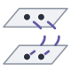
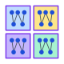
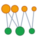

# Package index

## Plot basics

Start a plot from a multilayer network, see what each component can be
set to and what the plot sends to MiRA, open it in the browser, and save
it to a file.

- 
  [`mira()`](https://ggmira.ecomplab.com/reference/mira.md) : Start a
  plot: a multilayer network to draw in MiRA
- 
  [`mira_options()`](https://ggmira.ecomplab.com/reference/mira_options.md)
  : What each component can be set to, for a network
- 
  [`mira_spec()`](https://ggmira.ecomplab.com/reference/mira_spec.md) :
  What a plot sends to MiRA
- 
  [`print(`*`<mira_plot>`*`)`](https://ggmira.ecomplab.com/reference/print.mira_plot.md)
  : Open a mira plot in the browser
- 
  [`mira_save()`](https://ggmira.ecomplab.com/reference/mira_save.md) :
  Save a mira plot as an image file

## Elements: nodes, links, layers

One component per element of the plot. `color_by` and `size_by` map an
attribute of the data; `color`, `size` and `shape` set constants.

- 
  [`mira_node()`](https://ggmira.ecomplab.com/reference/mira_node.md) :
  Nodes: color, size, shape and labels
- 
  [`mira_intralayer()`](https://ggmira.ecomplab.com/reference/mira_intralayer.md)
  : Intralayer links: color, weight filter and arrowheads
- 
  [`mira_interlayer()`](https://ggmira.ecomplab.com/reference/mira_interlayer.md)
  : Interlayer links: show, color, curvature and layer pairs
- 
  [`mira_layer()`](https://ggmira.ecomplab.com/reference/mira_layer.md)
  : Layers: color, names and arrangement

## Scales

How data values become colors and sizes.

- 
  [`mira_scales`](https://ggmira.ecomplab.com/reference/mira_scales.md)
  : Scales: how data values become colors and sizes

## Layout

Where the nodes go.

- 
  [`mira_layout()`](https://ggmira.ecomplab.com/reference/mira_layout.md)
  : Layout: where the nodes go

## Camera

How the stack of layers is looked at.

- 
  [`mira_camera()`](https://ggmira.ecomplab.com/reference/mira_camera.md)
  : Camera: rotate, tilt, zoom and pan the view

## Legends

Which legends are open, and where.

- 
  [`mira_legends()`](https://ggmira.ecomplab.com/reference/mira_legends.md)
  : Legends: which are open, and where

## Data: what is drawn

Draw only part of the network.

- 
  [`mira_filter()`](https://ggmira.ecomplab.com/reference/mira_filter.md)
  : Filter: draw only some nodes, links or layers

## Views: MiRA’s modes

Open the plot in another view. A plot opens in one view; the other
components still apply.

- 
  [`mira_mode`](https://ggmira.ecomplab.com/reference/mira_mode.md) :
  Views: open the plot in another of MiRA's views
- 
  [`mira_mode_grid()`](https://ggmira.ecomplab.com/reference/mira_mode_grid.md)
  : Grid: open the plot with the layers side by side
- 
  [`mira_mode_map()`](https://ggmira.ecomplab.com/reference/mira_mode_map.md)
  : Map: open the plot with the layers on a geographic map
- 
  [`mira_mode_layer()`](https://ggmira.ecomplab.com/reference/mira_mode_layer.md)
  : Layer view: open the plot with one bubble per layer
- 
  [`mira_mode_meta()`](https://ggmira.ecomplab.com/reference/mira_mode_meta.md)
  : Meta-network: open the plot as the network aggregated over layers
- 
  [`mira_mode_dashboard()`](https://ggmira.ecomplab.com/reference/mira_mode_dashboard.md)
  : Dashboard: open the plot as summary charts
- 
  [`mira_mode_data()`](https://ggmira.ecomplab.com/reference/mira_mode_data.md)
  : Data: open the plot as the data tables

## Opening a network with MiRA’s defaults

- 
  [`plot_mira()`](https://ggmira.ecomplab.com/reference/plot_mira.md)
  [`plot_multilayer()`](https://ggmira.ecomplab.com/reference/plot_mira.md)
  : Open a network in MiRA with MiRA's defaults

## Feedback

Send feedback from R, with a GitHub account. On these pages: select text
and click Feedback, click the speech bubble next to a heading, or use
the Feedback button.

- 
  [`mira_feedback()`](https://ggmira.ecomplab.com/reference/mira_feedback.md)
  : Send feedback on ggmira
