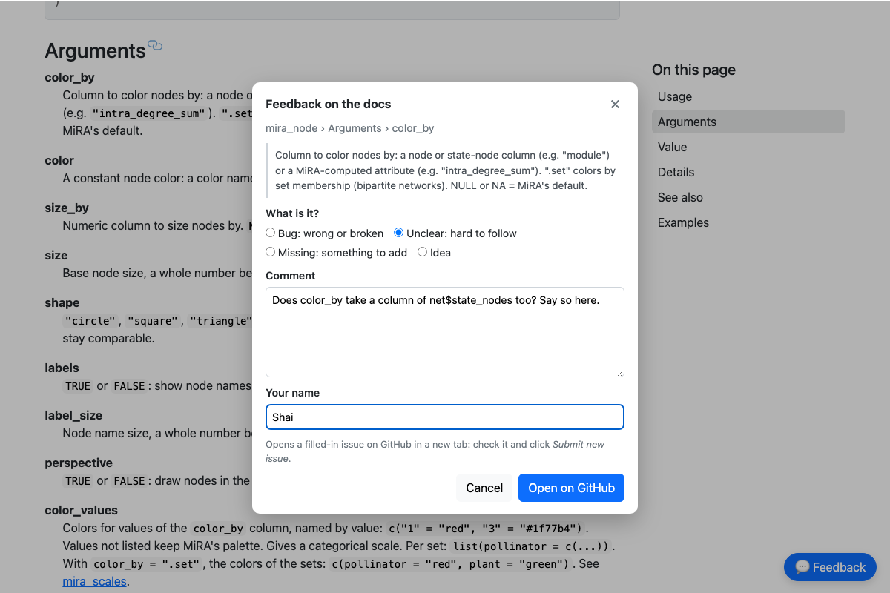

Thank you for testing ggmira. Please try it on the examples and, above all,
on a network of your own, and report anything that is wrong, confusing or
missing.

## 1. Install

R 4.1 or later:

```r
install.packages(c("remotes", "emln", "pkgdown", "rmarkdown"))
remotes::install_github("Ecological-Complexity-Lab/ggmira")
```

To get fixes and new features later, run `install_github()` again and
restart R.

## 2. Build the manual

The site is not published yet; build it from a clone of the repository:

```bash
git clone https://github.com/Ecological-Complexity-Lab/ggmira.git
```

```r
pkgdown::build_site("path/to/ggmira", examples = FALSE)
pkgdown::preview_site("path/to/ggmira")
```

## 3. What to try

- *Get started*: run it step by step.
- *Reference*: run a few examples from each page (`?mira_node`,
  `?mira_scales`, ...). `?ggmira` lists the functions.
- Your own network: build it with `emln::create_multilayer_network()`,
  then make the plot you would want for a paper or a talk.
- Each plot opens in the browser; stop them all with
  `httpuv::stopAllServers()`.

## 4. Leave feedback

Report what is wrong, confusing or missing, and also what you could not
figure out how to do, even if nothing broke. Every way below opens a new
GitHub issue, already filled in: check it and click *Submit new issue*
(sign in to GitHub first).

- **On a page of this site:**
  - select text, and click the *💬 Feedback* bubble next to it;
  - or click the 💬 next to a heading (it shows when the mouse is over the
    heading) for feedback on that section;
  - or click the *💬 Feedback* button at the bottom right, for the page.

  The issue gets the page, section, argument and the selected text; add
  what you expected. Pick the type: bug, unclear, missing or idea.

- **From R,** for example when something breaks while you work:

  ```r
  mira_feedback("mira_node", "color_limits seems ignored with color_by = \".set\"")
  mira_feedback("Getting started", "Step 6: what is a link condition?", type = "unclear")
  ```

  The issue gets your R session (R, ggmira and package versions).

- **In MiRA:** its *Feedback* button, for the visualizer itself.

With a bug, add the code you ran and, if it helps, a screenshot of MiRA
(paste it into the issue before submitting).

```{r, echo = FALSE, eval = TRUE, out.width = "100%", fig.alt = "A page of the ggmira site with text selected and the feedback form open"}

```
