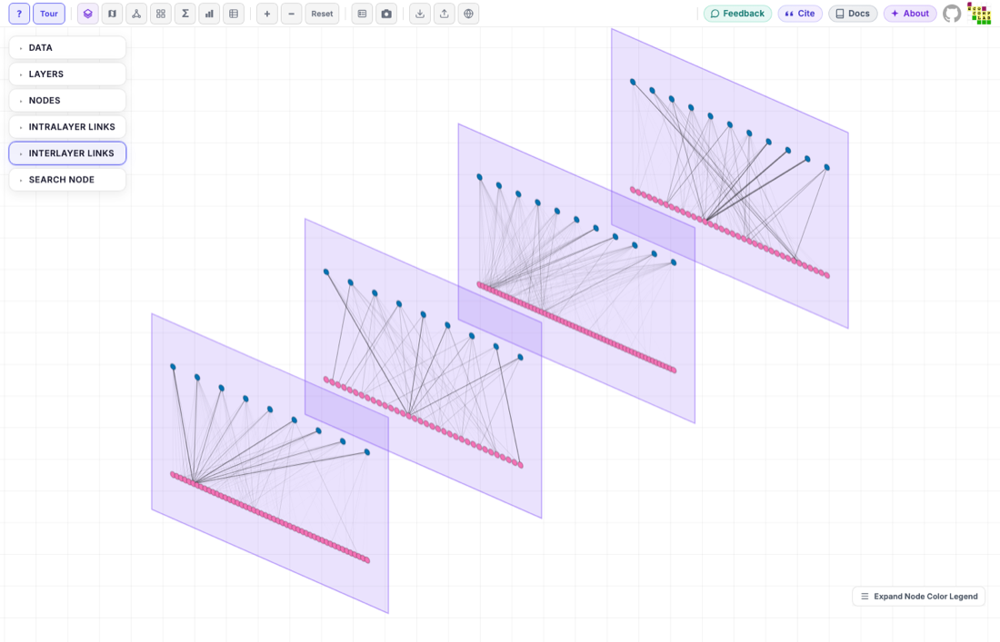
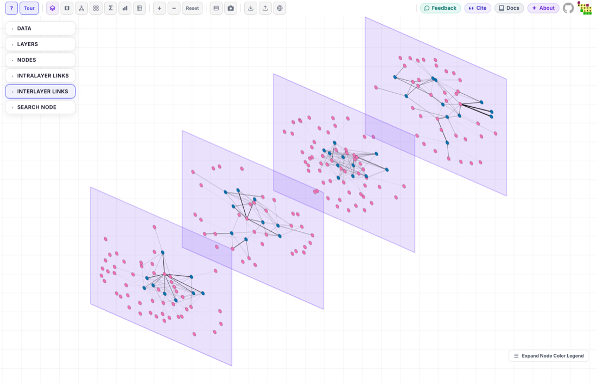
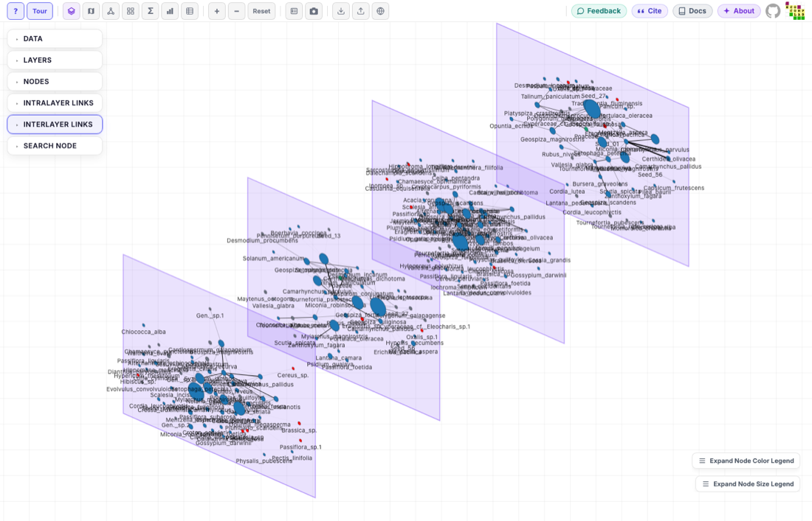
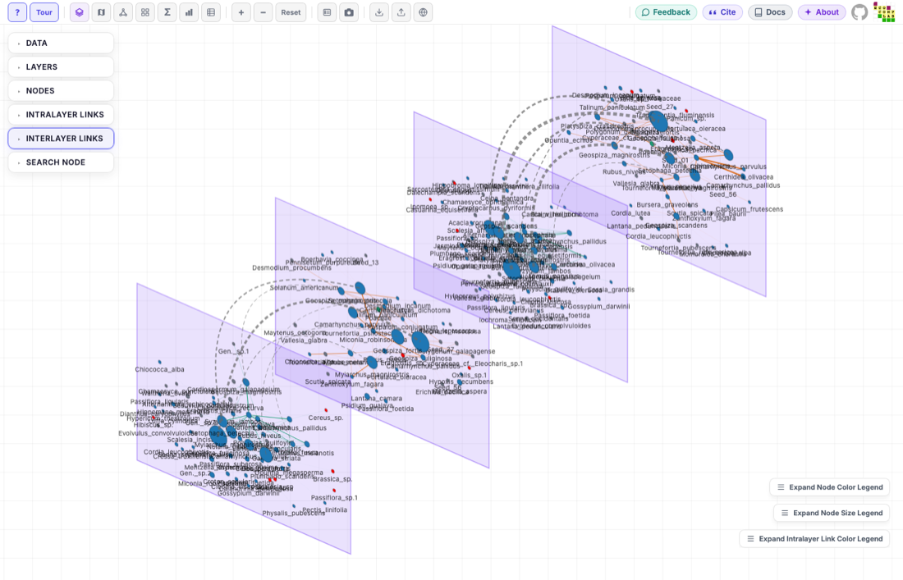
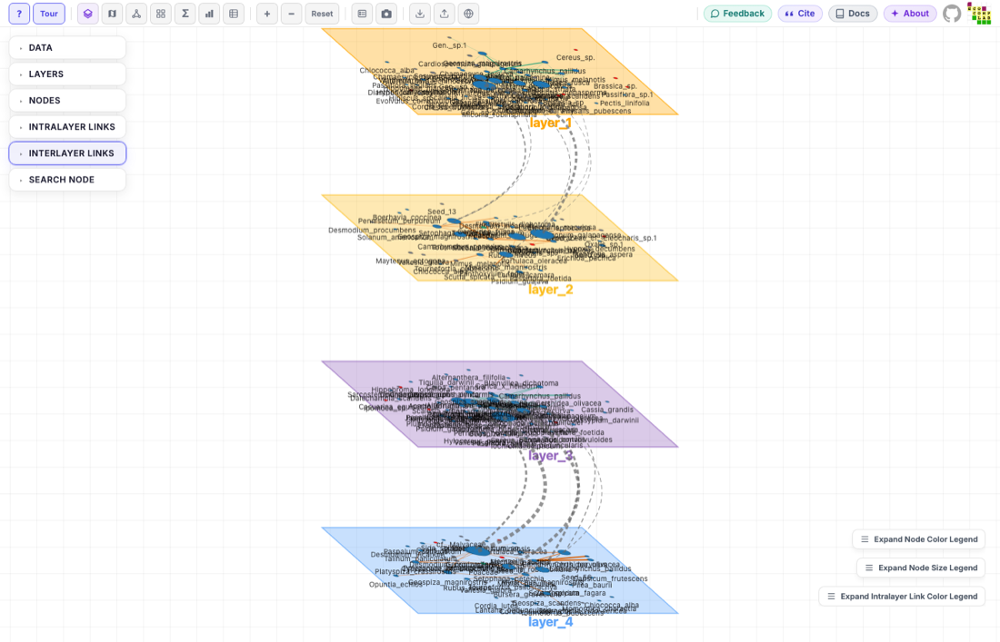
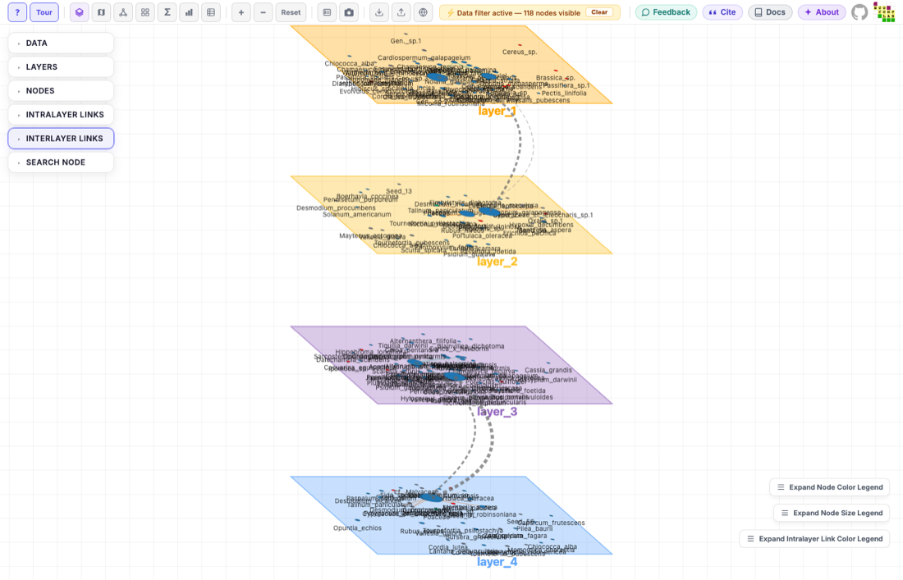
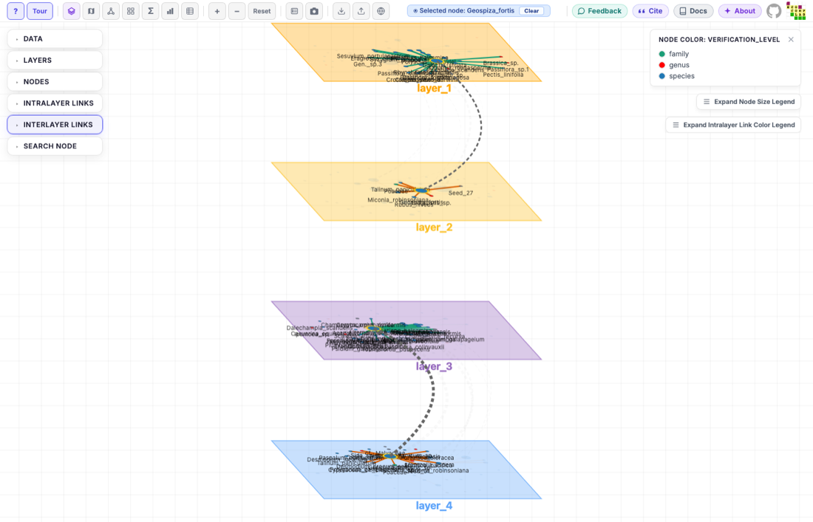
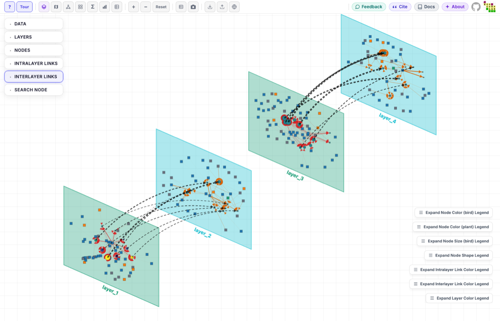
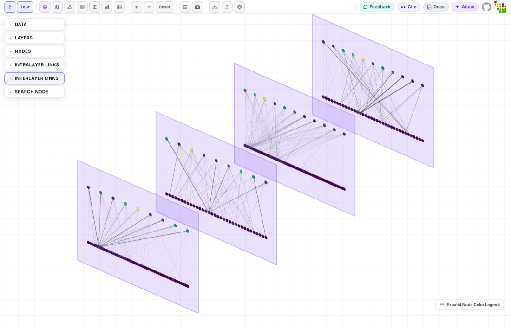
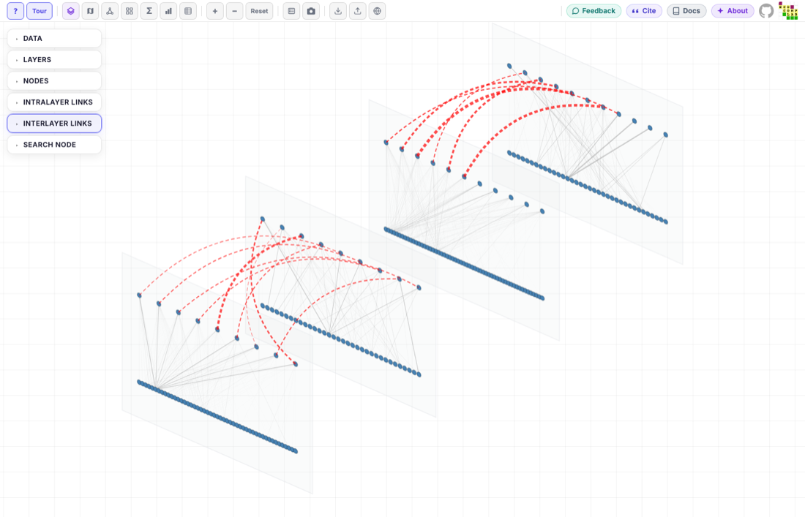

```{r, include = FALSE}
knitr::opts_chunk$set(
  collapse = TRUE,
  comment = "#>",
  eval = FALSE
)
```

```{r, include = FALSE, eval = TRUE}
library(ggmira)
```

ggmira draws multilayer networks in [MiRA](https://mira.ecomplab.com/), the
browser-based multilayer network visualizer, and describes how they should
look with code, the way ggplot2 does: start from the network with `mira()`
and add **components** with `+`, one per part of the plot. Printing the plot
opens it in the browser with the settings applied; everything can still be
changed in MiRA's interface.

This article builds one plot up, a component at a time, on emln network 17:
four layers (pollination and seed dispersal on two Galápagos islands), two
node sets (birds and plants), and interlayer links between layers 1–2 and
3–4. The screenshots show what each step looks like when it opens.

```{r}
library(emln)
library(ggmira)

net <- load_emln(17)
```

Each plot starts a small local server; stop them all with
`httpuv::stopAllServers()`.

## 1. The plot

`mira()` starts the plot. Printing it (typing its name) opens the network
with MiRA's default view: a bipartite layout, nodes colored by set.

```{r}
p <- mira(net, bipartite = TRUE, setA_type = "bird")
p
```

```{r, echo = FALSE, eval = TRUE, out.width = "100%"}

```

## 2. Layout: where the nodes go

`mira_layout()` chooses the layout algorithm; a `seed` makes the positions
reproducible. Adding a component to `p` gives a new plot, so you can keep
the result (`p <- p + ...`) or just look at it (`p + ...`).

```{r}
p <- p + mira_layout("kamada_kawai", seed = 42)
p
```

```{r, echo = FALSE, eval = TRUE, out.width = "100%"}

```

## 3. Nodes

In every element component, `color_by` and `size_by` map an attribute of
the data: a column of the network's tables, or one MiRA computes, such as
`intra_degree_sum`. `color`, `size` and `shape` set constants. Here nodes
are colored by their taxonomic verification level, with two levels given
colors by hand (`color_values`; the third keeps MiRA's palette), sized by
degree, and labeled.

```{r}
p <- p + mira_node(
  color_by = "verification_level",
  color_values = c(genus = "red", species = "#1f77b4"),
  size_by = "intra_degree_sum", size = 8,
  labels = TRUE, label_size = 10
)
p
```

```{r, echo = FALSE, eval = TRUE, out.width = "100%"}

```

On a bipartite network, `color_by`, `size_by` and `shape` also take one
value per node set, named by `node_type`: `color_by = c(bird =
"intra_degree_sum", plant = NA)` colors birds by degree and leaves plants in
MiRA's default (see `?mira_node`).

## 4. Links

`mira_intralayer()` styles the links within layers: here colored by the
link column `type`, with the weakest links hidden. `mira_interlayer()`
styles the links between layers; MiRA hides them by default, and `pairs`
shows only those between some layers (and turns them on).

```{r}
p <- p +
  mira_intralayer(color_by = "type", min_weight = 0.01) +
  mira_interlayer(color = "grey40", curvature = 0.8, min_weight = 0.5,
                  pairs = list(c("layer_1", "layer_2"), c("layer_3", "layer_4")))
p
```

```{r, echo = FALSE, eval = TRUE, out.width = "100%"}

```

## 5. Layers

`mira_layer()` colors the layers (by a layer column, or one color per layer
with `color_by = "layer_name"`), shows their names, and arranges them:
`stack` and `spacing`.

```{r}
p <- p + mira_layer(
  color_by = "layer_name",
  color_values = c(layer_1 = "orange", layer_3 = "#9467bd"),
  labels = TRUE, label_size = 18,
  stack = "vertical", spacing = 250
)
p
```

```{r, echo = FALSE, eval = TRUE, out.width = "100%"}

```

## 6. Filter: draw part of the network

`mira_filter()` keeps some nodes or links, with a condition on the columns
of the network's tables, as in `subset()`: `nodes` on `net$nodes`, `links`
on `net$extended`. Here, all plants and two finches; a hidden node hides
its links. MiRA shows "Data filter active", with a button to remove the
filter.

```{r}
p + mira_filter(nodes = type == "plant" |
                  node_name %in% c("Geospiza_fuliginosa", "Geospiza_fortis"))
```

```{r, echo = FALSE, eval = TRUE, out.width = "100%"}

```

## 7. Camera, legends and a highlighted node

Legends start minimized; `mira_legends()` opens them, all or some, and
`position` moves them. `mira_camera()` turns, tilts, zooms and pans the
view. `mira_node(highlight = )` makes a node and its neighbors stand out,
as when it is picked in MiRA's Search Node. In MiRA, all of this can
still be changed with the mouse.

```{r}
p + mira_legends(show = c("node_color", "layer_color"), position = "top-right") +
  mira_camera(rotate = 60, tilt = 25) +
  mira_node(highlight = "Geospiza_fortis")
```

```{r, echo = FALSE, eval = TRUE, out.width = "100%"}

```

The same plot in one expression, as in ggplot2:

```{r}
mira(net, bipartite = TRUE, setA_type = "bird") +
  mira_layout("kamada_kawai", seed = 42) +
  mira_node(color_by = "verification_level",
            color_values = c(genus = "red", species = "#1f77b4"),
            size_by = "intra_degree_sum", size = 8,
            labels = TRUE, label_size = 10) +
  mira_intralayer(color_by = "type", min_weight = 0.01) +
  mira_interlayer(color = "grey40", curvature = 0.8, min_weight = 0.5,
                  pairs = list(c("layer_1", "layer_2"), c("layer_3", "layer_4"))) +
  mira_layer(color_by = "layer_name",
             color_values = c(layer_1 = "orange", layer_3 = "#9467bd"),
             labels = TRUE, label_size = 18,
             stack = "vertical", spacing = 250)
```

Anything not set keeps MiRA's default. When a setting is given twice, the
later component wins, so `p + mira_node(color = "grey50")` recolors the
nodes of `p` and keeps everything else.

## Scales: how values become colors

In every component, `color_by` chooses what is colored; `color_values` and
`color_scale` in the same component choose the colors (`?mira_scales`):

- `color_scale = "categorical"` gives each value its own color;
  `"continuous"` a gradient (numeric columns only). Without it, MiRA
  decides from the data.
- `color_values` sets the colors of some values, named by value (numbers
  need quotes: `c("1" = "red")`). Values not listed keep MiRA's palette.
- MiRA keeps one scale per attribute name, so components that color by the
  same attribute share its colors.

Here the two node sets get different scales. The network's links run from
plant to bird, so with `directed = TRUE` birds have in-degrees and
in-strengths, which MiRA computes.

```{r}
p2 <- mira(net, bipartite = TRUE, setA_type = "bird", directed = TRUE) +
  mira_layout("kamada_kawai", seed = 3) +
  mira_node(
    color_by = c(bird = "intra_in_strength", plant = "verification_level"),
    # birds: in-strength is numeric, so a gradient
    # plants: categorical, two levels with manual colors
    color_values = list(plant = c(species = "#1f77b4", genus = "#ff7f0e")),
    # birds sized by in-degree; plants keep the default size
    size_by = c(bird = "intra_in_degree", plant = NA),
    perspective = FALSE
  ) +
  # links colored by "type" both here and in mira_interlayer(): one shared
  # scale; the two components name different values, so their colors merge
  mira_intralayer(color_by = "type", color_values = c(pollination = "#d62728"),
                  arrow_size = 0.5) +
  mira_interlayer(show = TRUE, color_by = "type",
                  color_values = c(interlayer = "black"), curvature = 0.2) +
  mira_layer(color_by = "interaction_type", color_scale = "categorical",
             color_values = c("seed-dispersal" = "#17becf"),
             labels = TRUE, stack = "horizontal", spacing = 450)
p2
```

```{r, echo = FALSE, eval = TRUE, out.width = "100%"}

```

### The same attribute, two scale types

```{r}
# MiRA's default for a numeric attribute with many values: a gradient
mira(net, bipartite = TRUE, setA_type = "bird") +
  mira_node(color_by = "intra_degree_sum", color_scale = "continuous")
```

```{r, echo = FALSE, eval = TRUE, out.width = "100%"}

```

```{r}
# categorical: one color per degree value
mira(net, bipartite = TRUE, setA_type = "bird") +
  mira_node(color_by = "intra_degree_sum", color_scale = "categorical")
```

```{r, echo = FALSE, eval = TRUE, out.width = "100%"}
knitr::include_graphics("figures/scale-categorical.png")
```

## Constant colors

`color` sets one color for all nodes, links or layers. A component takes
`color_by` or `color`, not both.

```{r}
mira(net, bipartite = TRUE, setA_type = "bird") +
  mira_node(color = "steelblue", shape = "circle") +
  mira_intralayer(color = "grey60") +
  mira_interlayer(show = TRUE, color = "red") +
  mira_layer(color = "#e5e7eb")
```

```{r, echo = FALSE, eval = TRUE, out.width = "100%"}

```

## When something is wrong

When a setting cannot work (a bipartite layout on a network that is not
bipartite, a layer name that does not exist), adding the component is an
error. When it looks wrong (a column that is not in the network, a value
that is not in the column), R warns and MiRA keeps its default for that
setting.

## Where next

- The [reference](../reference/index.html) lists every component with
  examples that build a plot step by step: `?mira_node`, `?mira_layer`, …
- `?mira_scales` explains colors and sizes in full.
- An example file uses every argument of every component:
  `file.edit(system.file("examples", "mira_examples.R", package = "ggmira"))`.
