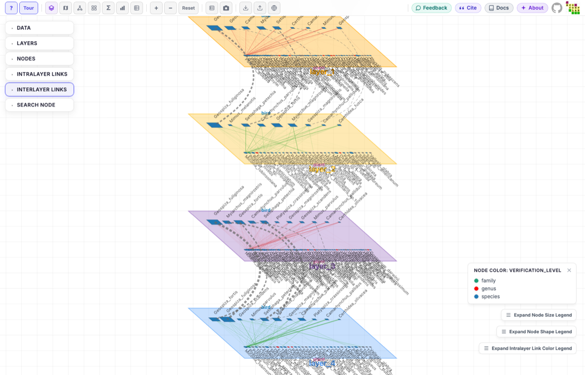
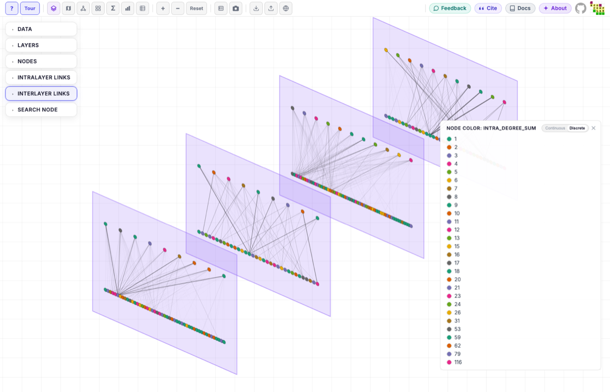

```{r, include = FALSE}
knitr::opts_chunk$set(
  collapse = TRUE,
  comment = "#>",
  eval = FALSE
)
```

```{r, include = FALSE, eval = TRUE}
library(ggmira)
```

ggmira draws multilayer networks in [MiRA](https://mira.ecomplab.com/), the
browser-based multilayer network visualizer, and describes how they should
look with code, the way ggplot2 does: start from the network with `mira()`
and add pieces with `+`. Printing the plot opens it in the browser, with the
settings applied; everything can still be changed in MiRA's interface.

The examples below use emln network 17: four layers (pollination and seed
dispersal on two Galápagos islands), two node sets (birds and plants), and
interlayer links between layers 1–2 and 3–4. The screenshots show what each
plot looks like when it opens. All the code is also in a file installed with
the package:

```{r}
file.edit(system.file("examples", "mira_examples.R", package = "ggmira"))
```

```{r}
library(emln)
library(ggmira)

net <- load_emln(17)
```

Each plot starts a small local server; stop them all with
`httpuv::stopAllServers()`.

## Layout, labels and layers

```{r}
p1 <- mira(net, bipartite = TRUE, setA_type = "bird") +
  # reproducible bipartite layout, nodes sorted by degree
  mira_layout("bipartite", seed = 42, nested = TRUE) +
  mira_node(
    color_by = "verification_level",
    # two levels with manual colors; "family" keeps the palette color
    color_values = c(genus = "red", species = "#1f77b4"),
    # node size by degree (computed by MiRA), base size 8
    size_by = "intra_degree_sum", size = 8,
    # birds as squares, plants as circles
    shape = c(bird = "square", plant = "circle"),
    # node names; nodes drawn in the layers' 3D perspective
    labels = TRUE, label_size = 10, perspective = TRUE
  ) +
  mira_intralayer(
    color_by = "type",
    color_values = c(pollination = "#d62728", "seed-dispersal" = "#2ca02c"),
    # hide links with weight below 0.01
    min_weight = 0.01
  ) +
  # pairs: only links between layers 1-2 and 3-4 (and turns interlayer links on)
  mira_interlayer(
    color = "grey40", min_weight = 0.5, curvature = 0.8,
    pairs = list(c("layer_1", "layer_2"), c("layer_3", "layer_4"))
  ) +
  # one color per layer: two set by hand, the others keep MiRA's colors
  mira_layer(
    color_by = "layer_name",
    color_values = c(layer_1 = "orange", layer_3 = "#9467bd"),
    # layer names, node set names, layers stacked top to bottom
    labels = TRUE, label_size = 18, set_labels = TRUE,
    stack = "vertical", spacing = 250
  )
p1
```

```{r, echo = FALSE, eval = TRUE, out.width = "100%"}

```

## Color scales

In every piece, `color_by` chooses what is colored; `color_values` and
`color_scale` in the same piece choose the colors.

- `color_scale = "categorical"` gives each value its own color;
  `"continuous"` a gradient (numeric columns only). Without it, MiRA
  decides from the data.
- `color_values` sets the colors of some values, named by value (numbers
  need quotes: `c("1" = "red")`). Values not listed keep MiRA's palette.
  They give a categorical scale.
- MiRA keeps one scale per attribute name, so pieces that color by the same
  attribute share its colors.

```{r}
# directed = TRUE: in/out degrees and arrowheads
p2 <- mira(net, bipartite = TRUE, setA_type = "bird", directed = TRUE) +
  mira_layout("kamada_kawai", seed = 3) +
  mira_node(
    color_by = c(bird = "verification_level", plant = "intra_in_degree"),
    # birds: categorical, two levels with manual colors
    # plants: no manual colors; in-degree is numeric, so a gradient
    color_values = list(bird = c(species = "#1f77b4", genus = "#ff7f0e")),
    # birds sized by out-degree; plants keep the default size
    size_by = c(bird = "intra_out_degree", plant = NA),
    # flat nodes
    perspective = FALSE
  ) +
  # links colored by "type" both here and in mira_interlayer(): one shared
  # scale; the two pieces name different values, so their colors merge
  mira_intralayer(
    color_by = "type", color_values = c(pollination = "#d62728"),
    arrow_size = 0.5
  ) +
  mira_interlayer(
    show = TRUE, color_by = "type", color_values = c(interlayer = "black"),
    curvature = 0.2
  ) +
  # layers by interaction type; one value with a manual color
  mira_layer(
    color_by = "interaction_type", color_scale = "categorical",
    color_values = c("seed-dispersal" = "#17becf"),
    labels = TRUE, stack = "horizontal", spacing = 450
  )
p2
```

```{r, echo = FALSE, eval = TRUE, out.width = "100%"}
knitr::include_graphics("figures/scales.png")
```

### The same attribute, two scale types

```{r}
# MiRA's default for a numeric attribute with many values: a gradient
mira(net, bipartite = TRUE, setA_type = "bird") +
  mira_node(color_by = "intra_degree_sum", color_scale = "continuous")
```

```{r, echo = FALSE, eval = TRUE, out.width = "100%"}
knitr::include_graphics("figures/scale-continuous.png")
```

```{r}
# categorical: one color per degree value
mira(net, bipartite = TRUE, setA_type = "bird") +
  mira_node(color_by = "intra_degree_sum", color_scale = "categorical")
```

```{r, echo = FALSE, eval = TRUE, out.width = "100%"}

```

## Constant colors

`color` sets one color for all nodes, links or layers. A piece takes
`color_by` or `color`, not both.

```{r}
mira(net, bipartite = TRUE, setA_type = "bird") +
  mira_node(color = "steelblue", shape = "circle") +
  mira_intralayer(color = "grey60") +
  mira_interlayer(show = TRUE, color = "red") +
  mira_layer(color = "#e5e7eb")
```

```{r, echo = FALSE, eval = TRUE, out.width = "100%"}
knitr::include_graphics("figures/constant.png")
```

## What a plot sends to MiRA

`mira_spec()` shows the settings a plot sends, after merging its pieces:
as an R list, or as the JSON MiRA receives.

```{r}
mira_spec(p2)
cat(mira_spec(p2, json = TRUE))
```

A piece prints as the call that makes it:

```{r, eval = TRUE}
mira_node(color_by = "module", color_values = c("1" = "red"))
```

When a setting cannot work (a bipartite layout on a network that is not
bipartite, a layer name that does not exist), adding the piece is an error.
When it looks wrong (a column that is not in the network, a value that is
not in the column), R warns and MiRA keeps its default for that setting.
